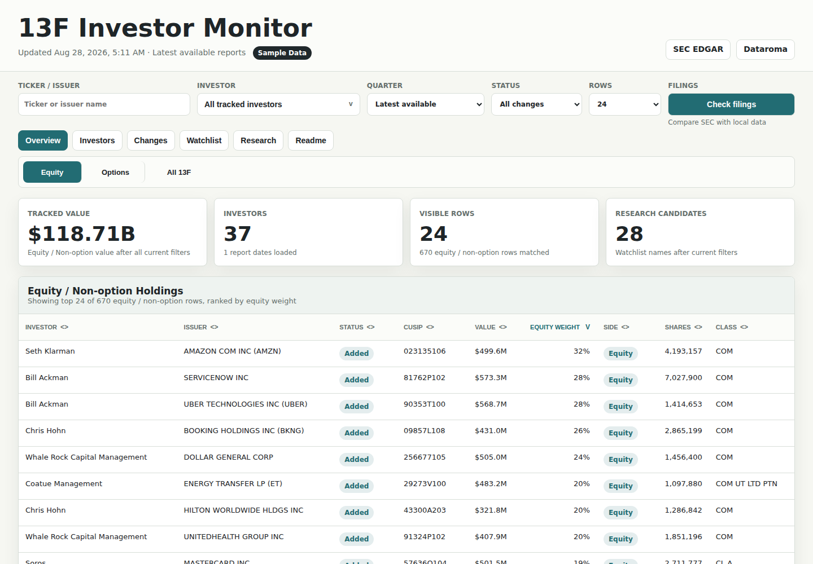
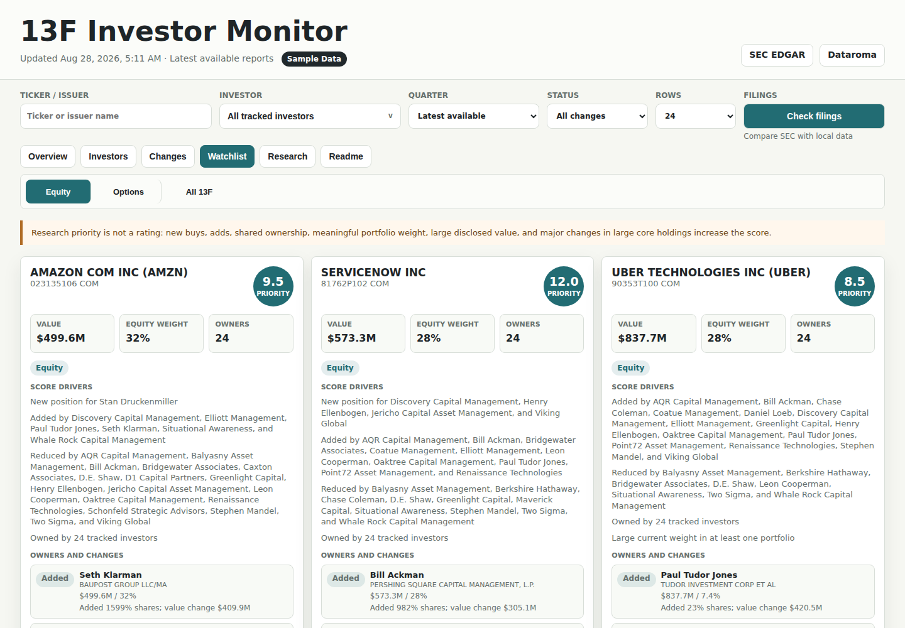

# 13F Investor Monitor

A local-first dashboard for tracking what 37 well-known institutional investors
report holding each quarter. It pulls 13F filings straight from SEC EDGAR,
computes quarter-over-quarter changes, and surfaces a research queue of
positions worth a closer look.

Everything runs on your own machine. There is no hosted service, no account,
and no telemetry — the only outbound requests go to SEC EDGAR and, if you
supply keys, the optional market-data providers.



The watchlist scores each position as a research queue and shows its reasoning,
so a score is auditable rather than a black box:



Both screenshots use `--sample` data, which is deterministic — clone the repo,
run the sample command below, and you get exactly this.

## What it does

- Discovers each investor's 13F filings through the SEC EDGAR submissions API.
- Parses the filing archive's XML information tables into normalized holdings.
- Computes quarter-over-quarter deltas: new buys, adds, reductions, exits.
- Reports concentration, a turnover proxy, and cross-investor ownership.
- Scores a watchlist as a research queue, browsable in the UI.

## Quick start

Requires Python 3.10 or newer. The only hard dependency is `requests`.

```bash
git clone https://github.com/<you>/13f-monitoring.git
cd 13f-monitoring
python3 -m pip install -r requirements.txt
```

**Try it without pulling from SEC.** `--sample` generates deterministic demo
data in seconds, which is the fastest way to see what the dashboard does:

```bash
python3 scripts/refresh_data.py --sample
python3 scripts/dashboard_server.py --port 8013
```

**Pull real filings.** SEC asks automated clients to identify themselves, so set
a user agent with your own contact address first:

```bash
export SEC_USER_AGENT="13F Monitoring local dashboard your-email@example.com"
python3 scripts/refresh_data.py --quarters 6
python3 scripts/dashboard_server.py --port 8013
```

The dashboard lives at `http://127.0.0.1:8013/dashboard/`. On macOS the server
opens it in a new Google Chrome window; everywhere else it prints the URL for
you to open yourself. Pass `--no-open` to skip the launch entirely.

**No data ships with this repo.** A full pull runs to roughly 1.6 GB, so `data/`
is git-ignored and `refresh_data.py` is what populates it. Expect the first real
pull to take a while — SEC rate limits apply, and `--quarters` defaults to 20.

Start the dashboard with `scripts/dashboard_server.py` rather than
`python3 -m http.server` — the Research tab depends on the local API endpoints
that only the project's own server provides.

## Configuration

Copy `.env.example` to `.env` and fill in what you want. Every key is optional;
without one, the matching panel simply reports that it is unconfigured.

| Variable | Effect if unset |
| --- | --- |
| `SEC_USER_AGENT` | Falls back to a placeholder. SEC may return 403. |
| `FMP_API_KEY` | No Financial Modeling Prep ratings, price targets, or past-earnings lookup. |
| `FINNHUB_API_KEY` | No Finnhub recommendation trends or price targets (used as an FMP fallback). |
| `OPENAI_API_KEY` | Filing Q&A prepares local SEC context to paste elsewhere instead of answering directly. |
| `OPENAI_MODEL` | Defaults to `gpt-5.2`. |

`.env` is git-ignored. Keys stay on the local server and are redacted from any
error message the browser can see.

If SEC returns 403 or the network fails, `refresh_data.py` leaves the existing
dashboard output untouched unless you pass `--allow-empty`.

Pulling deeper history is a matter of the quarter count — `--quarters 20`, the
default, keeps roughly five years of filings under `data/raw/`, with SEC
responses cached in `data/cache/`. Add `--refresh-cache` to re-fetch responses
that are already cached.

## Data sources

- **SEC EDGAR submissions JSON** — filing discovery.
- **SEC filing archive XML** — the information tables that hold the positions. This is the source of record.
- **Dataroma** and **WhaleWisdom** — reference layers for filer names and portfolio context, useful for manual lookup. Neither is authoritative here.

## Coverage

The investor registry lives in `investors.json`. Add an entry with a CIK to
track someone new.

<details>
<summary>37 tracked investors</summary>

| Investor | Filing entity | CIK |
| --- | --- | --- |
| Seth Klarman | BAUPOST GROUP LLC/MA | 0001061768 |
| Chris Hohn | TCI FUND MANAGEMENT LTD | 0001647251 |
| David Tepper | APPALOOSA LP | 0001656456 |
| Chase Coleman | TIGER GLOBAL MANAGEMENT LLC | 0001167483 |
| Leon Cooperman | COOPERMAN LEON G | 0000898382 |
| Stephen Mandel | LONE PINE CAPITAL LLC | 0001061165 |
| Paul Tudor Jones | TUDOR INVESTMENT CORP ET AL | 0000923093 |
| Henry Ellenbogen | DURABLE CAPITAL PARTNERS LP | 0001798849 |
| Bill Ackman | PERSHING SQUARE CAPITAL MANAGEMENT, L.P. | 0001336528 |
| Stan Druckenmiller | DUQUESNE FAMILY OFFICE LLC | 0001536411 |
| Millennium Management | MILLENNIUM MANAGEMENT LLC | 0001273087 |
| Citadel | CITADEL ADVISORS LLC | 0001423053 |
| Point72 Asset Management | Point72 Asset Management, L.P. | 0001603466 |
| Coatue Management | COATUE MANAGEMENT LLC | 0001135730 |
| D.E. Shaw | D. E. Shaw & Co., Inc. | 0001009207 |
| Elliott Management | Elliott Investment Management L.P. | 0001791786 |
| Two Sigma | TWO SIGMA INVESTMENTS, LP | 0001179392 |
| Discovery Capital Management | DISCOVERY CAPITAL MANAGEMENT, LLC / CT | 0001389507 |
| Schonfeld Strategic Advisors | Schonfeld Strategic Advisors LLC | 0001665241 |
| D1 Capital Partners | D1 Capital Partners L.P. | 0001747057 |
| Rokos Capital Management | Rokos Capital Management LLP | 0001666335 |
| Daniel Loeb | Third Point LLC | 0001040273 |
| Berkshire Hathaway | BERKSHIRE HATHAWAY INC | 0001067983 |
| Whale Rock Capital Management | Whale Rock Capital Management LLC | 0001387322 |
| AQR Capital Management | AQR CAPITAL MANAGEMENT LLC | 0001167557 |
| Bridgewater Associates | Bridgewater Associates, LP | 0001350694 |
| Balyasny Asset Management | BALYASNY ASSET MANAGEMENT L.P. | 0001218710 |
| Jericho Capital Asset Management | Jericho Capital Asset Management L.P. | 0001525234 |
| Caxton Associates | CAXTON ASSOCIATES LLP | 0002051323 |
| Carl Icahn | ICAHN CARL C | 0000921669 |
| Soros | SOROS FUND MANAGEMENT LLC | 0001029160 |
| Maverick Capital | MAVERICK CAPITAL LTD | 0000934639 |
| Greenlight Capital | GREENLIGHT CAPITAL INC | 0001079114 |
| Oaktree Capital Management | OAKTREE CAPITAL MANAGEMENT LP | 0000949509 |
| Renaissance Technologies | RENAISSANCE TECHNOLOGIES LLC | 0001037389 |
| Viking Global | VIKING GLOBAL INVESTORS LP | 0001103804 |
| Situational Awareness | Situational Awareness LP | 0002045724 |

</details>

## What 13F data cannot tell you

This matters more than any feature in the dashboard:

- Filings are **delayed** — generally up to 45 days after quarter-end. You are always looking at a stale snapshot.
- They show **long US equity positions only**. No shorts, no cash, no most non-US holdings, no private positions, no full derivatives exposure, no FX, rates, or commodities.
- A "position" may be a hedge, a leg of a pair trade, or collateral, and nothing in the filing distinguishes those from conviction.
- From 2023 onward, SEC 13F XML values are rounded to the nearest dollar. Older filings may need a different normalization rule, so long-horizon value comparisons deserve a second look.

The watchlist is a research queue. It is not a recommendation, and nothing here
is investment advice.

## Project layout

```text
dashboard/          Static front end
  index.html
  styles.css
  app.js
scripts/
  refresh_data.py       Pulls and rebuilds data/processed/
  dashboard_server.py   Local server plus the Research tab API
src/thirteenf/
  sec_client.py         EDGAR fetching and response caching
  parser.py             Information-table XML to holdings
  analytics.py          Deltas, concentration, watchlist scoring
  sample_data.py        Deterministic demo data for --sample runs
investors.json      The registry of tracked filers
data/                Generated, git-ignored
```

## License

MIT. See [LICENSE](LICENSE).
